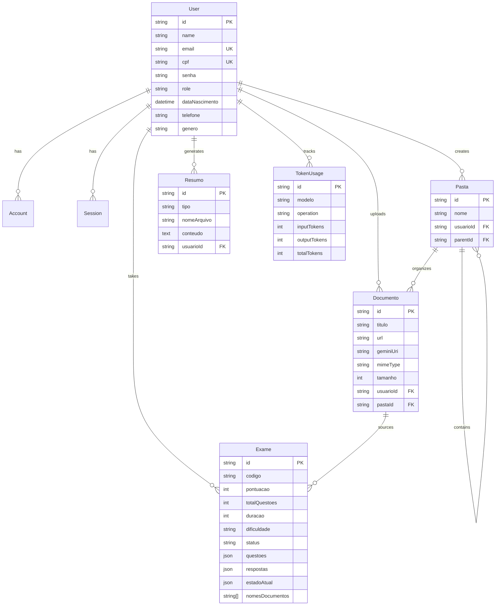
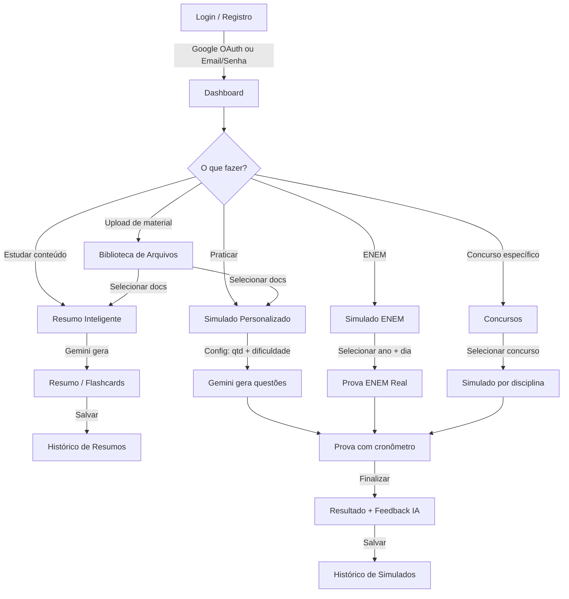

# EstudaAI — Resumo Detalhado do Sistema

## 1. Visão Geral

O **EstudaAI** é uma plataforma web de estudos inteligente voltada para estudantes de concursos públicos, universitários e pesquisadores. Permite que o usuário faça upload de materiais de estudo (PDFs, TXT), e utiliza **IA generativa (Google Gemini)** para gerar resumos inteligentes, flashcards e simulados personalizados com correção automática e feedback detalhado.

> [!TIP]
> O nome do projeto no código é `estudos-ai` (v0.1.0), hospedado na Vercel e com banco PostgreSQL.

---

## 2. Stack Tecnológica

| Camada | Tecnologia | Detalhes |
|---|---|---|
| **Framework** | Next.js 16 (App Router) | React 19, TypeScript 5 |
| **Estilização** | TailwindCSS v4 | PostCSS, tema dark por padrão |
| **Banco de Dados** | PostgreSQL | Via Prisma ORM v5 |
| **IA Generativa** | Google Gemini | `@ai-sdk/google`, `@google/generative-ai`, SDK `ai` |
| **Autenticação** | NextAuth v5 (beta 30) | Google OAuth + Credentials (email/senha) |
| **Armazenamento** | Supabase Storage | `@supabase/supabase-js` para PDFs |
| **Rate Limiting** | Upstash Redis | Sliding window distribuído |
| **Testes** | Vitest + Testing Library | Com MSW para mocks de API |
| **Deploy** | Vercel | CLI `vercel` no devDependencies |
| **Validação** | Zod v4 | Schema validation para inputs |
| **Gráficos** | Recharts v3 | Dashboard de desempenho |
| **Tipografia** | Google Fonts | Geist + Geist Mono |

---

## 3. Arquitetura de Diretórios

```
/
├── prisma/
│   └── schema.prisma           # 7 modelos (User, Documento, Exame, Resumo, etc.)
├── src/
│   ├── app/                    # App Router (páginas + API routes)
│   │   ├── api/                # 14 rotas de API
│   │   ├── admin/              # Painel administrativo (tokens)
│   │   ├── biblioteca/         # Gestão de arquivos/pastas
│   │   ├── concursos/          # Catálogo de concursos com simulados por disciplina
│   │   ├── dashboard/          # Dashboard principal do usuário
│   │   ├── enem/               # Simulados ENEM por ano/dia
│   │   ├── historico/          # Histórico de simulados e resumos
│   │   ├── login/ + register/  # Autenticação
│   │   ├── resumo/             # Geração de resumos por IA
│   │   ├── resumos/            # Visualização detalhada + flashcards
│   │   ├── resultado/          # Resultado detalhado de exames
│   │   └── simulado/           # Simulação de provas (ativo + resultado)
│   ├── components/             # Componentes React reutilizáveis
│   │   ├── auth/               # SessionProvider
│   │   ├── exam/               # QuestionScreen, ResultDashboard, ActiveExamIndicator
│   │   ├── layout/             # Sidebar, ClientLayout, MainLayoutWrapper
│   │   └── theme/              # ThemeProvider (dark/light)
│   ├── contexts/               # 3 Context Providers
│   │   ├── DocumentContext     # Estado de documentos carregados
│   │   ├── ExamContext         # Estado de simulados genéricos
│   │   └── EnemExamContext     # Estado de simulados ENEM
│   ├── lib/                    # Utilitários e configuração
│   │   ├── auth.ts             # Configuração NextAuth
│   │   ├── prisma.ts           # Singleton do Prisma Client
│   │   ├── supabase.ts         # Cliente Supabase
│   │   ├── rateLimit.ts        # Rate limiting com Upstash Redis
│   │   ├── tokenTracking.ts    # Rastreamento de uso de tokens da IA
│   │   ├── concursos-data.ts   # Catálogo de 10 concursos com disciplinas
│   │   ├── enem-config.ts      # Config dos dias do ENEM (seções, tempos)
│   │   └── validations.ts      # Schemas de validação (Zod)
│   ├── proxy.ts                # Middleware de autenticação e proteção de rotas
│   └── types/                  # Tipos TypeScript centralizados
├── public/                     # Arquivos estáticos
└── src/Provas/                 # JSONs de provas anteriores do ENEM
```

---

## 4. Modelos de Dados (Prisma)



> [!NOTE]
> O modelo `User` estende o schema padrão do NextAuth (`Account`, `Session`, `VerificationToken`) com campos customizados como `cpf`, `senha`, `role`, `telefone` e `genero`.

---

## 5. Rotas de API (14 endpoints)

| Rota | Função |
|---|---|
| `POST /api/register` | Cadastro de conta com email/senha (bcrypt) |
| `GET/POST /api/auth/[...nextauth]` | Autenticação NextAuth (Google + Credentials) |
| `POST /api/upload` | Upload de arquivos para Supabase Storage + registro no DB |
| `POST /api/upload-temp` | Upload temporário direto para o Gemini File Manager |
| `GET /api/documents` | Lista documentos do usuário |
| `POST /api/folders` | CRUD de pastas na biblioteca |
| `POST /api/generate-exam` | Gera simulado via IA (Gemini) a partir de documentos |
| `POST /api/generate-summary` | Gera resumo/flashcards via IA |
| `POST /api/save-exam` | Salva resultado final do exame no DB |
| `POST /api/save-questions` | Persiste questões geradas pela IA |
| `POST /api/save-resumo` | Salva resumo/flashcards no DB |
| `POST /api/exam-state` | Persiste estado parcial do exame (progresso) |
| `POST /api/analyze-exam` | Análise detalhada de desempenho via IA |
| `GET /api/admin/tokens` | Dashboard admin de uso de tokens |

---

## 6. Funcionalidades Principais

### 6.1 📚 Biblioteca de Arquivos (`/biblioteca`)
- Upload de PDFs e TXT para Supabase Storage
- Organização em **pastas hierárquicas** (suporte a subpastas)
- Upload simultâneo de múltiplos arquivos
- Armazenamento da URI do Gemini (`geminiUri`) para processamento IA
- Loading skeleton durante carregamento

### 6.2 📝 Resumo Inteligente (`/resumo`)
- Seleção de documentos da biblioteca para análise pela IA
- Upload temporário direto para o Gemini (sem salvar na biblioteca)
- Geração de **resumos estruturados** com pontos-chave
- Geração de **flashcards** interativos
- Dois tipos de visualização: detalhado (`/resumos/detalhado`) e flashcard (`/resumos/flashcard`)
- Histórico de resumos (`/historico/resumos`)

### 6.3 🎯 Simulados Personalizados (`/simulado`)
- Geração de questões de múltipla escolha baseadas nos documentos enviados
- Configuração de **quantidade de questões** e **nível de dificuldade** (fácil, médio, difícil)
- **Cronômetro regressivo** baseado na dificuldade
- Persistência de **estado parcial** do exame (para retomar depois)
- Indicador de exame ativo na sidebar (`ActiveExamIndicator`)
- Resultado com dashboard de acertos/erros e explicações
- Código curto legível por exame (ex: `A3F2`)
- Histórico de simulados (`/historico/simulados`)

### 6.4 🏛️ Concursos Públicos (`/concursos`)
- Catálogo de **10 concursos** pré-configurados (PF, PRF, INSS, Receita Federal, BB, Caixa, Tribunais, Militares, AGU, MPU/DPU)
- Cada concurso inclui: banca, órgão, nível, salário base, disciplinas
- Geração de simulados focados por disciplina específica

### 6.5 📖 Simulado ENEM (`/enem`)
- Provas reais do ENEM por **ano** (2017–2025) e **dia** (Dia 1 / Dia 2)
- Dia 1: Linguagens + Ciências Humanas (90 questões, 5h30)
- Dia 2: Ciências da Natureza + Matemática (90 questões, 5h)
- Seleção de idioma (Inglês/Espanhol) no Dia 1
- JSONs de provas armazenados em `src/Provas/ENEM/{ano}/`
- Sistema extensível: basta adicionar novo JSON + atualizar `provasDisponiveis`

### 6.6 📊 Dashboard (`/dashboard`)
- Visão geral do desempenho do estudante
- Gráficos via Recharts (histórico de notas, acertos por área)
- Loading skeleton durante carregamento

### 6.7 🔑 Painel Admin (`/admin`)
- Monitoramento de **uso de tokens** da IA por operação e modelo
- Acesso restrito a usuários com `role = "ADMIN"`

---

## 7. Autenticação e Segurança

### Autenticação
- **NextAuth v5** com estratégia JWT
- **Dois provedores**: Google OAuth e Credentials (email/senha com bcrypt)
- Adaptador Prisma para persistência de contas
- Callback JWT que injeta `role` do usuário no token

### Middleware de Proteção ([proxy.ts](file:///Users/apolo/Documents/Estudaai/src/proxy.ts))
- Rotas protegidas: `/dashboard`, `/simulado`, `/resumo`, `/resumos`, `/historico`, `/biblioteca`, `/concursos`, `/enem`, `/admin`
- Redireciona usuários não autenticados para `/login`
- Redireciona autenticados em `/login`/`/register` para `/dashboard`
- Bloqueio de rotas admin para não-admins

### Segurança HTTP ([next.config.ts](file:///Users/apolo/Documents/Estudaai/next.config.ts))
- Content Security Policy (CSP) rigorosa
- `X-Frame-Options: DENY` (anti-clickjacking)
- `X-Content-Type-Options: nosniff`
- HSTS (1 ano + subdomínios)
- `Permissions-Policy` restritiva (câmera, microfone, geolocalização desabilitados)

### Rate Limiting ([rateLimit.ts](file:///Users/apolo/Documents/Estudaai/src/lib/rateLimit.ts))
- Upstash Redis com sliding window distribuído
- 4 categorias:
  - **IA**: 5 req/60s
  - **Upload**: 10 req/60s
  - **Registro**: 5 req/300s
  - **Padrão**: 30 req/60s
- Graceful degradation: se Redis indisponível, permite acesso sem limite

---

## 8. Integrações Externas

| Serviço | Uso |
|---|---|
| **Google Gemini** | Geração de resumos, flashcards, questões e análise de desempenho |
| **Supabase Storage** | Armazenamento persistente de PDFs e documentos |
| **Gemini File Manager** | Upload de arquivos para processamento IA (via `geminiUri`) |
| **Upstash Redis** | Rate limiting distribuído para ambientes serverless |
| **Google OAuth** | Login social via conta Google |

---

## 9. Contextos React (Estado Global)

| Context | Arquivo | Responsabilidade |
|---|---|---|
| `DocumentContext` | [DocumentContext.tsx](file:///Users/apolo/Documents/Estudaai/src/contexts/DocumentContext.tsx) (6.9 KB) | Gerencia documentos carregados, upload, pastas |
| `ExamContext` | [ExamContext.tsx](file:///Users/apolo/Documents/Estudaai/src/contexts/ExamContext.tsx) (18.6 KB) | Estado completo do simulado (questões, respostas, timer, persistência) |
| `EnemExamContext` | [EnemExamContext.tsx](file:///Users/apolo/Documents/Estudaai/src/contexts/EnemExamContext.tsx) (9.1 KB) | Estado específico do simulado ENEM (ano, dia, idioma) |

> [!IMPORTANT]
> O `ExamContext` é o maior context (18.6 KB), indicando que a lógica do simulado é complexa — inclui gerenciamento de cronômetro, persistência de estado parcial via API, fluxo de questões e cálculo de resultados.

---

## 10. Fluxo do Usuário



---

## 11. Rastreamento de Tokens

O sistema registra todo uso de tokens da IA na tabela `TokenUsage`:
- **Modelo utilizado** (padrão: `gemini-2.5-flash`)
- **Operação** (`generate_resumo`, `generate_exame`, etc.)
- **Tokens de entrada, saída e total**
- **Vinculado ao usuário** para controle de custos
- Dashboard admin para monitoramento em `/admin/tokens`

---

## 12. Testes

- **Framework**: Vitest v4 com JSDOM
- **Bibliotecas**: Testing Library (React + User Event)
- **Mocking**: MSW (Mock Service Worker) + `vitest-mock-extended`
- **Diretórios de testes**: `src/components/__tests__/`, `src/lib/__tests__/`, `src/app/biblioteca/__tests__/`
- **Comandos**: `npm test` (run), `npm run test:watch` (watch mode)

---

## 13. Características Técnicas Notáveis

- **App Router**: Usa o padrão moderno do Next.js com `layout.tsx` e `page.tsx` por rota
- **Skeleton Loading**: Todas as páginas principais possuem `loading.tsx` com skeleton animado
- **Dark Mode por padrão**: Via `next-themes` com `defaultTheme="dark"`
- **Exportação PDF**: Botão para exportar resumos/resultados via `react-to-pdf` e `html2canvas-pro`
- **Tipagem forte**: Tipos centralizados em `src/types/index.ts` derivados do Prisma
- **Validação dupla**: Frontend (Zod) + modelo Prisma para integridade dos dados
- **Estado persistente de exame**: O estado parcial do exame é salvo na API, permitindo retomar uma prova após fechar o navegador
